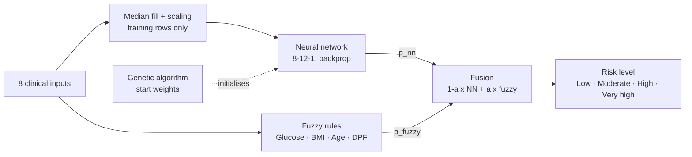
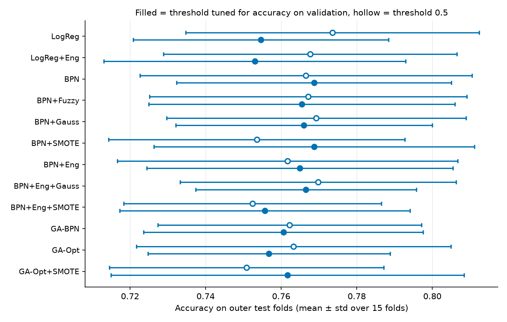
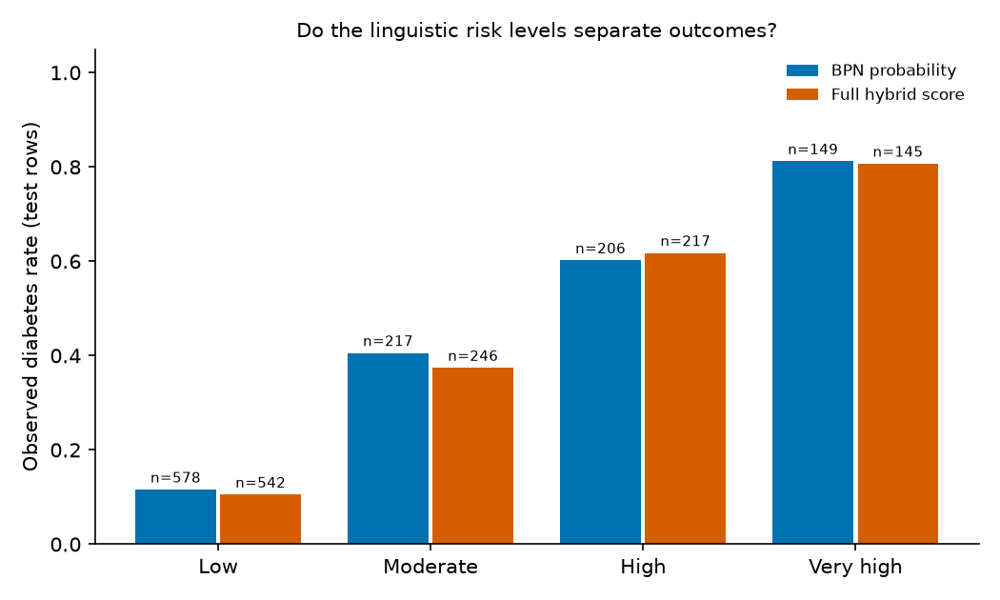
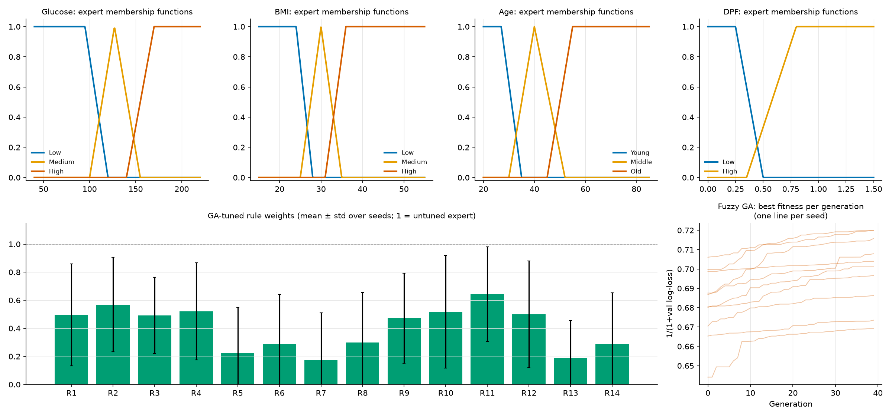

<div align="center">

# 🧬 GlycoSense

### A GA-Optimised Neural-Fuzzy System for Diabetes Risk Estimation

**Backpropagation neural network · Genetic algorithm · Fuzzy inference**
built from scratch in NumPy, and evaluated honestly on the Pima Indians Diabetes data.


</div>

> ⚠️ **Educational project, not a medical device.** The model has not been clinically validated and must not be used for diagnosis. A low score does **not** rule out diabetes.

---

## 📑 Contents

- [Overview](#-overview)
- [Key findings](#-key-findings)
- [How it works](#-how-it-works)
- [Quick start](#-quick-start)
- [The Streamlit app](#-the-streamlit-app)
- [Reproducing the experiments](#-reproducing-the-experiments)
- [Results at a glance](#-results-at-a-glance)
- [Evaluation protocol (no leakage)](#-evaluation-protocol-no-leakage)
- [Repository structure](#-repository-structure)
- [Data notes](#-data-notes)
- [Limitations](#-limitations)
- [Documentation](#-documentation)
- [Syllabus mapping](#-syllabus-mapping)
- [References](#-references)

---

## 🔭 Overview

Given eight routine clinical measurements (pregnancies, glucose, blood pressure, skin thickness, insulin, BMI, diabetes pedigree function, age), the system estimates diabetes risk **and explains it**.

| Technique | Role | Where |
|---|---|---|
| 🧠 **Neural network** (8-12-1, backprop + momentum) | Learns inputs → risk | `diabetes_ga_bpn.py` |
| 🧬 **Genetic algorithm** | Start weights · feature selection · hyperparameters | `diabetes_ga_bpn.py`, `accuracy_experiment.py` |
| 🌫️ **Fuzzy logic** (zero-order Sugeno, 14 rules) | Clinical rules, linguistic risk levels, explanations | `fuzzy_layer.py` |
| ➕ **Data augmentation** | Gaussian generator and SMOTE (both from scratch) | `augment.py` |

Everything (network, GA, fuzzy system, SMOTE, statistical tests) is written in plain NumPy so that **every step can be read and explained**. No DEAP, PyGAD or sklearn MLP is used for the models.

---

## 🎯 Key findings

The project reports what the experiments actually show, including the unflattering parts.

- **No tested component improved accuracy significantly.** Every model, from logistic regression to the full hybrid, reaches about **0.75–0.77 accuracy** and **0.83–0.84 AUC**. None of the 12 paired accuracy comparisons is significant (p ≥ 0.33).
- **Recall changes are trade-offs, not better ranking.** SMOTE raises recall from 0.595 to 0.751 at threshold 0.5, but AUC stays at 0.838: it moves the decision boundary instead of improving discrimination.
- **The fuzzy layer's real value is interpretability.** Fuzzy risk levels track observed outcomes (diabetes rate **0.11 → 0.37 → 0.62 → 0.81** from Low to Very high) and every prediction comes with the rules that fired.
- **The simplest defensible model is logistic regression** (holdout accuracy 0.766, 95% CI 0.693–0.826).
- On 768 noisy rows, accuracy is limited by the **data**, not by model sophistication.

---

## ⚙️ How it works



**Why late fusion?** The network and its training stay untouched, the fuzzy layer can be switched off (`a = 0`) for a clean ablation, and the rules provide a human-readable explanation.

<details>
<summary><b>Neural network</b></summary>

8 inputs → 12 sigmoid hidden units → 1 sigmoid output; 121 weights in one flat vector. Binary cross-entropy, full-batch gradient descent, learning rate 0.1, momentum 0.9, 200 epochs.
</details>

<details>
<summary><b>Genetic algorithm</b></summary>

Real-coded, tournament selection (k = 3), uniform crossover (0.8), Gaussian mutation (0.1, σ = 0.3), elitism 2. Three uses:

1. **Start weights**: chromosome = the 121 network weights, fitness `1/(1+MSE)`, then 100 epochs of backprop.
2. **Feature and hyperparameter selection**: 15 feature on/off genes + hidden units, learning rate, momentum, epochs; fitness = inner cross-validated accuracy.
3. **Fuzzy tuning** (first study only): rule weights, membership shifts/stretches and fusion weight (it overfit the small validation set).
</details>

<details>
<summary><b>Fuzzy layer</b></summary>

Trapezoidal membership functions on Glucose, BMI, Age and DPF, anchored on clinical cut-offs. Rules look like `IF Glucose is High AND BMI is High THEN risk = 0.95` (AND = min). Output: `p_fuzzy = Σ w·s·r / Σ w·s`. The fused score is mapped to four overlapping linguistic levels.
</details>

<details>
<summary><b>Augmentation and features</b></summary>

**Gaussian**: one multivariate Gaussian per class (log scale for skewed features), clipped to the training range, class ratio preserved. **SMOTE**: interpolation between minority neighbours, balances classes 50:50. **Engineered features**: Glucose×BMI, Age×BMI, Age×Glucose, log(DPF), Glucose², BMI², Pregnancies/Age. Synthetic rows are only ever added to training data.
</details>

---

## 🚀 Quick start

```bash
git clone <your-repo-url>
cd diabetes_ga_bpn

# create an environment and install packages (uv shown; pip works too)
uv venv
uv pip install -r requirements.txt
# activate: .venv\Scripts\activate (Windows)  |  source .venv/bin/activate (macOS/Linux)

python -m streamlit run app.py
```

Then open <http://localhost:8501>.

> **Windows "Application Control" errors?** On some managed machines `streamlit.exe` (or `python.exe` inside the venv) is blocked by policy. Starting the app with `python -m streamlit run app.py` avoids the launcher; if the venv interpreter itself is blocked, run the same command with a system or uv-managed Python and point `PYTHONPATH` at the venv's `Lib\site-packages`.

Run all commands **from the project folder** (the scripts read `diabetes.csv` from the current directory).

---

## 🖥️ The Streamlit app

A self-contained, seven-tab application. Everything shown in the Results and Discussion tabs is read from the generated result files, so the app always matches the experiments.

| Tab | Contents |
|---|---|
| 🩺 **Risk Assessment** | Enter a patient's values → risk score, fuzzy risk level, and the most active rules |
| 📘 **Overview** | Problem, objectives, syllabus mapping, pipeline diagram |
| 🗂 **Data** | Dataset, preprocessing, live feature statistics and class histograms |
| 🧠 **Methodology** | Network, GA, fuzzy layer (with interactive sliders), augmentation, evaluation protocol |
| 📊 **Results** | Accuracy study, hybrid study, synthetic-data realism, GA feature selection |
| 💡 **Discussion** | Where changes in performance come from, model selection, limitations |
| 📚 **References** | Sources |

Prediction uses `hybrid_model.npz` (GA + BPN + fuzzy) and falls back to `model.npz` if it is missing.

---

## 🔁 Reproducing the experiments

| Script | What it does | Needs | Time |
|---|---|---|---|
| `python diabetes_ga_bpn.py` | Original experiment: plain BPN vs GA-BPN over 10 splits; writes `model.npz` | numpy, pandas, sklearn, matplotlib | not timed |
| `python extension_recall_ga.py` | F1-fitness GA, threshold tuning, convergence, paired t-tests | + scipy | not timed |
| `python hybrid_experiment.py` | **Study 1**: BPN, GA+BPN, BPN+Fuzzy, full hybrid, ± synthetic data; writes `results_hybrid.*`, `hybrid_model.npz`, figures | numpy, pandas, matplotlib | ~30 s |
| `python accuracy_experiment.py` | **Study 2**: threshold tuning, SMOTE vs Gaussian, engineered features, GA feature/hyperparameter search, 5-fold CV × 3, holdout; writes `results_accuracy.*`, figures | numpy, pandas, matplotlib | ~7 min |

All runs are seeded and reproducible. Figures are written next to the scripts; the app looks in `figs/` first, then the project root.

---

## 📊 Results at a glance

Cross-validated test performance, threshold tuned for accuracy on a validation set (mean ± std over 15 test folds; full tables in [`results_accuracy.md`](results_accuracy.md)):

| Model | Accuracy | Recall | F1 | AUC |
|---|---|---|---|---|
| Logistic regression | 0.755 ± 0.034 | 0.506 | 0.584 | 0.838 |
| BPN | 0.769 ± 0.036 | 0.571 | 0.627 | 0.838 |
| BPN + fuzzy rules | 0.765 ± 0.041 | 0.570 | 0.622 | 0.840 |
| BPN + Gaussian rows | 0.766 ± 0.034 | 0.501 | 0.595 | 0.838 |
| BPN + SMOTE | 0.769 ± 0.042 | 0.637 | 0.655 | 0.838 |
| BPN + engineered features | 0.765 ± 0.040 | 0.553 | 0.619 | 0.836 |
| GA-BPN (GA start weights) | 0.761 ± 0.037 | 0.560 | 0.614 | 0.838 |
| GA feature + hyperparameter search | 0.757 ± 0.032 | 0.504 | 0.587 | 0.834 |

<table>
<tr>
<td></td>
<td></td>
</tr>
<tr>
<td align="center"><sub>Accuracy per model (filled: tuned threshold, hollow: 0.5)</sub></td>
<td align="center"><sub>Observed diabetes rate per fuzzy risk level</sub></td>
</tr>
</table>

<table>
<tr>
<td></td>
</tr>
<tr>
<td align="center"><sub>Membership functions, GA-tuned rule weights and fuzzy-GA convergence</sub></td>
</tr>
</table>

---

## 🛡️ Evaluation protocol (no leakage)

1. **Final holdout**: 154 rows (20%), used once, for the chosen model only.
2. **Stratified 5-fold cross-validation × 3 repeats** on the remaining 614 rows (15 test folds).
3. **Inner validation split** (20% of each training part): used only for the decision threshold and fusion weight.
4. **Training-only statistics**: medians, scaler, SMOTE, the Gaussian generator and GA fitness never see test rows.
5. **Statistics**: Nadeau–Bengio corrected resampled t-test (Study 2) and exact paired sign-flip permutation tests (Study 1). No multiple-comparison correction is applied, so p-values are indicative only.

---

## 🗂️ Repository structure

```
diabetes_ga_bpn/
├── app.py                      # Streamlit application (7 tabs)
├── app_content.py              # Text and helpers for the app's information tabs
│
├── diabetes_ga_bpn.py          # Data loading, BPN, GA, original GA-BPN experiment
├── extension_recall_ga.py      # F1-fitness GA, threshold tuning, t-tests
├── fuzzy_layer.py              # Sugeno fuzzy system, risk levels, generic GA
├── augment.py                  # Gaussian generator, SMOTE, realism checks
├── features.py                 # Engineered features
├── hybrid_experiment.py        # Study 1: hybrid GA + NN + fuzzy
├── accuracy_experiment.py      # Study 2: accuracy-focused study
│
├── diabetes.csv                # Pima Indians Diabetes data (768 rows, no header)
├── model.npz                   # Saved GA-BPN weights (original experiment)
├── hybrid_model.npz            # Saved full hybrid used by the app
│
├── results_hybrid.md / .csv    # Generated results, Study 1
├── results_accuracy.md / .csv  # Generated results, Study 2
├── figs/                       # Figures
│
├── RESEARCH_PAPER.md / .docx   # Full research paper
├── REPORT_SECTION_results_discussion.md   # Results and Discussion section (also shown in the app)
├── HYBRID_REPORT_NOTES.md      # Notes on the hybrid study
└── requirements.txt
```

---

## 📝 Data notes

- **Dataset**: Pima Indians Diabetes (NIDDK; Smith et al., 1988): 768 women, 8 features, 500 negative / 268 positive. Check the licence of the copy you redistribute.
- **Missing values**: zeros in Glucose, BloodPressure, SkinThickness, Insulin and BMI are treated as missing and replaced by the training-set median.
- **`diabetes.csv` has no header.** An earlier version of the loader dropped the first patient (767 rows); the loader now detects a header explicitly, and every result here uses all 768 rows.
- If `diabetes.csv` is absent, `diabetes_ga_bpn.py` falls back to downloading the data.

---

## ⚠️ Limitations

- About 122 test rows per fold and 154 holdout rows: differences below ~3–5 accuracy points cannot be detected.
- Cross-validation folds overlap; p-values are indicative, and 12 (Study 2) / 45 (Study 1) comparisons are uncorrected.
- Failing to find a significant difference is weak evidence of equivalence.
- Membership functions and rules were set from clinical cut-offs by the authors before the experiments (not tuned afterwards).
- One dataset, one population; no external validation.
- Studies 1 and 2 use different splits and are not directly comparable in absolute numbers.

---

## 📚 Documentation

| Document | Description |
|---|---|
| [`RESEARCH_PAPER.md`](RESEARCH_PAPER.md) / [`.docx`](RESEARCH_PAPER.docx) | Full paper: methods, results, discussion, references |
| [`REPORT_SECTION_results_discussion.md`](REPORT_SECTION_results_discussion.md) | Results and Discussion section for the project report |
| [`results_accuracy.md`](results_accuracy.md), [`results_hybrid.md`](results_hybrid.md) | Auto-generated result tables |

---

## 🎓 Syllabus mapping

Mini project for *Neuro-Fuzzy and Genetic Programming*:

| Project part | Syllabus topic |
|---|---|
| 8-12-1 sigmoid network, backprop with momentum | Neuron model, BPN architecture and learning (Unit 1) |
| Membership functions, rules, Sugeno inference | Fuzzy sets and fuzzy inference (Unit 3) |
| Real-coded chromosome, fitness, selection, crossover, mutation | Genetic algorithm (Unit 4) |
| GA finds BPN start weights | GA-based weight determination, hybrid systems (Unit 5) |

---

## 📖 References

1. J. W. Smith et al., "Using the ADAP learning algorithm to forecast the onset of diabetes mellitus," *Proc. Symp. Computer Applications in Medical Care*, 1988.
2. D. E. Rumelhart, G. E. Hinton, R. J. Williams, "Learning representations by back-propagating errors," *Nature*, 1986.
3. D. E. Goldberg, *Genetic Algorithms in Search, Optimization and Machine Learning*, Addison-Wesley, 1989.
4. T. Takagi, M. Sugeno, "Fuzzy identification of systems and its applications to modeling and control," *IEEE Trans. SMC*, 1985.
5. N. V. Chawla et al., "SMOTE: Synthetic minority over-sampling technique," *JAIR*, 2002.
6. C. Nadeau, Y. Bengio, "Inference for the generalization error," *Machine Learning*, 2003.

The full reference list is in [`RESEARCH_PAPER.md`](RESEARCH_PAPER.md).

---

<div align="center">

**Author:** [Your name] · [Institution] · **Guide:** [Teacher's name]
**License:** [add a `LICENSE` file, e.g. MIT, before publishing]

</div>
